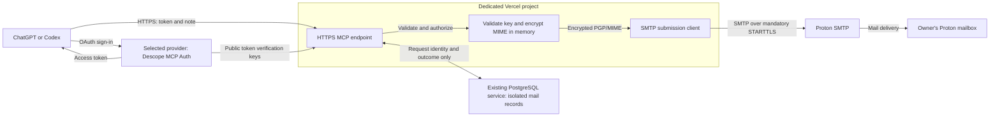

# Encrypted self-email MCP architecture

- **Status:** Design proposal; software implementation has not started.
- **Decision record date:** 2026-10-11.
- **Owner and intended user:** Ryan Anderson.

This document describes a private Model Context Protocol (MCP) service for
sending encrypted notes to the owner's Proton mailbox. It records requirements
confirmed during design, recommended technical decisions, their consequences,
and the evidence required before a future service can be enabled.

Approval of the documentation task authorizes this document and its README link
only. It does not authorize application development, dependency installation,
database changes, infrastructure provisioning, DNS changes, or email submission.
All interfaces and runtime behavior below are proposed, not implemented.

## Purpose and scope

The owner should be able to ask ChatGPT or Codex to email a note or report to
their own mailbox. The client supplies the content over HTTPS. The service
encrypts it with the owner's public PGP key before submitting it through SMTP.

### Confirmed requirements

| Requirement | Decision confirmed by the owner |
| --- | --- |
| Clients | Support both ChatGPT and Codex. |
| Authentication provider | Use Descope MCP Auth through Vercel Marketplace. Provider selection is confirmed; setup and interoperability are not yet verified. |
| Endpoint | Use `https://emailmcp.ryanpaulanderson.com/mcp`. |
| Destination | Send only to the owner's configured Proton mailbox on their custom email domain. The exact address is still unspecified. |
| Content | Accept text and Markdown notes; file attachments are outside the initial scope. |
| Encryption boundary | HTTPS to Vercel is acceptable; encrypt content on Vercel before SMTP submission. |
| Submission | Wait for the SMTP result and report it synchronously. |
| Persistence | Reuse the existing PostgreSQL service associated with the wedding website. |
| Subject | Let the model choose a visible subject using judgment about sensitivity; ask the owner when uncertain. Put the full title inside the encrypted content. |
| Engineering workflow | Include a local Docker-to-Docker SMTP test, documented automated checks and CI gates, and Dependabot maintenance. |

The service is an SMTP submission client. It does not operate an inbound SMTP
server or a general-purpose mail relay. Inbox access, arbitrary recipients,
scheduling, attachments, and a background delivery queue are outside this design.

## Architecture and trust boundaries

The AI client and Vercel runtime handle plaintext. The application must not
persist that plaintext in its database, filesystem, logs, or error reports. This
is not a claim that JavaScript memory can be securely erased, or that encryption
hides content from the originating AI client or hosting runtime.

After encryption, the SMTP submission carries ciphertext for the protected
content. PGP/MIME does not conceal the outer subject, sender, recipient, message
identifiers, timing, or message size. The configured authentication provider
handles sign-in, not email content. Proton describes these limits in its
[encryption explanation](https://proton.me/support/proton-mail-encryption-explained).

The proposed request flow is:

1. Authenticate the caller, authorize the owner, and validate bounded inputs.
2. Check whether the request ID already identifies an attempt. Return that
   outcome, or a conflict if the content differs, without sending again.
3. For a new request, validate the configured public key and encrypt the MIME
   content in memory.
4. Atomically reserve the request ID and enforce submission limits in
   PostgreSQL. Only the successful reservation may proceed to SMTP.
5. Complete one bounded SMTP attempt, then record and return its outcome.

## Architectural decisions

The status on each decision distinguishes the owner's requirements from
technical recommendations. A recommended implementation detail is not evidence
that the owner has selected a product or that the behavior exists today.

### ADR-001: Host a dedicated HTTPS MCP service on Vercel

**Status:** Vercel and the endpoint are confirmed requirements. The runtime and
framework below are recommendations.

Use a separate Vercel project with TypeScript, a supported Node.js LTS runtime
(Node.js 24 is the proposed baseline), Next.js route handlers, and Vercel's
`mcp-handler` integration. Use Streamable HTTP at `/mcp` and keep request handling
stateless apart from explicit PostgreSQL records. Pin compatible dependency
versions in the future implementation rather than treating this document as a
package manifest.

This follows Vercel's documented MCP deployment path and provides Node's SMTP
and cryptographic library support. A continuously running server would add an
operational dependency; an Edge runtime would constrain the required APIs. A
dedicated project allows independent configuration and releases from the wedding
application. [Vercel MCP hosting](https://vercel.com/docs/mcp/deploy-mcp-servers-to-vercel)

### ADR-002: Encrypt PGP/MIME before the transport receives a message

**Status:** Encryption on Vercel with the owner's public key is confirmed.
PGP/MIME and the library composition are recommended.

Use OpenPGP.js for encryption and Nodemailer's MIME-building facilities for
serialization. Build an inner UTF-8 MIME entity containing the title and body,
encrypt its bytes, and wrap the ciphertext in a PGP/MIME message. The outer
`multipart/encrypted` entity contains a version part and an encrypted-data part.
Only the completed encrypted message may reach the SMTP adapter.

The initial body representation is UTF-8 text. Markdown remains readable
Markdown source; HTML rendering is not part of the initial interface. Do not
load files or remote URLs from message content.

PGP/MIME is preferred over inline armored text because it provides a defined
message structure and Proton recommends it. An implicit encryption plugin or
reliance on the SMTP provider would weaken the explicit requirement that every
submission already contains ciphertext. Encryption failure must stop sending;
there is no plaintext fallback. [Proton PGP/MIME guidance](https://proton.me/support/pgp-mime-pgp-inline),
[Nodemailer MIME composition](https://nodemailer.com/extras/mailcomposer),
[Nodemailer raw-message submission](https://nodemailer.com/message/custom-source)

Use a public key belonging to the receiving Proton address, with its fingerprint
approved separately by the owner. No private key belongs in this service. Email
is encrypted but not PGP-signed; signature verification must not be claimed.

### ADR-003: Submit through Proton with mandatory STARTTLS

**Status:** SMTP submission to the owner's Proton mailbox is confirmed. Proton's
address-specific SMTP token service is the recommended transport.

Proton documents `smtp.protonmail.ch`, port `587`, STARTTLS, and a generated SMTP
token paired with a custom-domain address. Its current guide describes
eligibility for paid Proton Mail plans with custom-domain addresses; the owner's
actual entitlement has not been verified. Ordinary SMTP submission does not
itself provide end-to-end encryption. [Proton SMTP submission](https://proton.me/support/smtp-submission)

Require the TLS upgrade and normal certificate verification before
authentication. Use one connection per attempt, disable pooling, await the
result, and deterministically close the connection. The proposed baseline is a
30-second overall SMTP deadline within a 60-second function limit; the overall
deadline must close the socket, not merely stop waiting for its promise.

An HTTP email provider is an alternative, and Vercel generally recommends that
transport for reliability. Proton SMTP is proposed here to use the owner's
existing mail service. Vercel permits port 587, but the full exchange must
finish before the function responds. A local Proton Bridge process would add a
separate continuously running dependency. [Vercel email guidance](https://vercel.com/kb/guide/sending-emails-from-an-application-on-vercel),
[Nodemailer SMTP and TLS options](https://nodemailer.com/smtp)

### ADR-004: Delegate sign-in and enforce a single owner

**Status:** Support for both clients, private owner access, and Descope MCP Auth
through Vercel Marketplace are confirmed choices. No provider account or
integration has been provisioned. Account eligibility and client interoperability
still require validation.

The identity provider's role is to let the owner sign in and let the MCP service
verify who is making a request. The Proton SMTP token serves a different purpose:
it authorizes the service to submit mail to Proton. Neither that token nor the
PGP public key protects the public MCP endpoint from unauthorized callers.

Use managed OAuth authorization-code flow with PKCE rather than implementing an
authorization server in this repository. Vercel's Descope integration has a
dedicated MCP Auth product that provisions a Descope project, configures dynamic
client registration, and supplies application configuration. This is more
directly matched to the requirement than selecting a general sign-in integration
without assessing its MCP setup. Descope remains a separate hosted provider even
though Vercel manages the integration. [Vercel Descope integration](https://vercel.com/marketplace/descope)

Publish MCP protected-resource metadata and validate tokens on every request:
signature, exact issuer, intended audience, validity period, required scope, and
the configured owner's immutable subject identifier. Do not authorize by an
email string alone. Use `https://emailmcp.ryanpaulanderson.com/mcp` consistently
as the configured MCP resource, advertised resource identifier, authorization
and token request resource, and required token audience. Descope documents the
MCP server URL as a token audience; do not substitute its internal application
ID. Accept a string audience or an audience array only when it contains the
exact configured resource. Proposed scopes are `email:send:self` and
`email:status:self`. [Descope resource configuration](https://docs.descope.com/resources),
[Descope MCP token validation](https://docs.descope.com/agentic-identity-hub/core-components/mcp-servers)

Register the intended ChatGPT and Codex clients using their actual metadata and
callback addresses. Prefer supported client metadata discovery; do not invent
callback URLs or build a local proxy that claims to be the identity provider.
Require PKCE S256 for both clients and verify that the provider propagates the
same resource through authorization and token exchange. Managed registration
does not replace the application's owner and scope checks.
[OpenAI MCP authentication](https://developers.openai.com/plugins/build/auth),
[Descope MCP authorization](https://docs.descope.com/mcp)

This delegates login and token issuance while keeping mailbox authorization in
the MCP service. A static bearer secret is simpler for some clients but is not
the proposed shared sign-in solution. Vercel deployment protection alone does
not establish the intended user's application permissions.

#### Vercel connection and identity options evaluated

| Option | Established capability | Fit for this service |
| --- | --- | --- |
| Descope MCP Auth | Native Marketplace product specifically for remote MCP authentication, registration, consent, and authorization. | Selected by the owner; account setup, plan verification, and both-client acceptance tests remain outstanding. |
| Clerk | Native Marketplace integration and maintained MCP OAuth/discovery helpers. | Credible alternative. Verify this service's exact resource/audience and scope configuration before selecting it. |
| Auth0 | Native Marketplace integration that provisions an application and configuration, plus documented MCP authorization support. | Viable alternative; not uniquely required and no longer the unexamined default. |
| Vercel Connect | Brokered provider credentials, OAuth connections, project/environment links, and adapters. Its OAuth gateway also has documented inbound-token verification. | Useful connection infrastructure, but the reviewed documentation does not establish a complete direct ChatGPT/Codex sign-in solution for this new resource. Do not equate inbound verification with a public authorization flow. |
| Sign in with Vercel | OAuth/OIDC login using an existing Vercel account. | Possible login identity source. Its documented access tokens authorize Vercel APIs, so they are not automatically tokens for this mail resource. |
| Vercel Passport | Deployment-wide login through an external identity provider; available on Enterprise plans. | An additional deployment-access layer, not the selected MCP OAuth solution; it still requires an identity provider. |
| Vercel KMS | Managed signing keys and JWT signing. | A cryptographic primitive, not a complete login, registration, consent, or OAuth service. |
| Better Auth | Maintained, application-hosted authentication with an MCP plugin and database-backed state. | An alternative that reuses PostgreSQL but adds responsibility for authorization-server operation, migrations, and login/consent flows. |

Sources: [Clerk on Vercel](https://vercel.com/marketplace/clerk),
[Clerk MCP support](https://clerk.com/docs/guides/ai/overview),
[Auth0 on Vercel](https://vercel.com/marketplace/auth0),
[Vercel Connect](https://vercel.com/docs/connect),
[Connect inbound-token verification](https://vercel.com/docs/connect/frameworks/eve),
[Sign in with Vercel](https://vercel.com/docs/sign-in-with-vercel),
[Passport](https://vercel.com/docs/passport),
[Vercel KMS](https://vercel.com/docs/kms),
[Better Auth MCP](https://better-auth.com/docs/plugins/mcp).

Connect's custom OAuth connector discovers an existing provider and uses that
provider's authorization flow. The documented Auth.js adapter exchanges a code
using the project's Vercel OIDC credential. Neither description alone proves
that external ChatGPT and Codex clients can obtain correctly scoped gateway
tokens for this new email service. This is a limit of the reviewed evidence,
not a claim that Connect can never support inbound authentication.
[Custom OAuth connections](https://vercel.com/docs/connect/concepts/connectors),
[Connect OAuth adapter](https://vercel.com/docs/connect/frameworks/authjs)

For outbound mail credentials, Connect's generic API-key facility is a possible
alternative to a server-side secret. No ready-made Proton SMTP connection or
verified SMTP-token retrieval flow was established in this review. Keep the
documented Proton token approach unless that specific integration is verified;
do not add Connect merely because it supports other provider credentials.

The Marketplace currently labels Descope MCP Auth as Free, but this is not an
account-specific price guarantee. Verify quotas and the actual offer before
provisioning. The MCP hostname remains on the owner's Vercel domain; a separate
custom hostname for Descope's login/issuer is not required. Custom authentication
domains have separate plan requirements. [Descope pricing](https://www.descope.com/pricing)

### ADR-005: Reuse PostgreSQL with separate ownership and privileges

**Status:** Reusing the existing PostgreSQL service is confirmed. The isolation
mechanism is recommended and requires verification against the actual service.

Use a dedicated `email_mcp` schema, a restricted runtime role, and independently
owned migrations. Give that role only the operations required for mail metadata.
Do not reuse the wedding application's broad runtime credentials or migration
history. A schema name alone is not an access-control boundary; verify actual
privileges, including inherited and public grants.

If safe isolation requires a separate logical database on the same hosting
service, document and review that configuration before provisioning. Do not
alter wedding-table permissions or global roles as an incidental workaround.

This reuses the existing service while limiting accidental coupling. A new
database provider would increase administration. Sharing application tables or
credentials would create unnecessary access and migration risks. Service
availability and backup restoration remain shared dependencies even when access
is isolated. [PostgreSQL schemas and privileges](https://www.postgresql.org/docs/16/ddl-schemas.html)

### ADR-006: Record attempts and never automatically resend uncertain work

**Status:** Synchronous reporting is confirmed. The persistence and recovery
semantics below are recommended.

Identify each intended email with an owner-scoped request UUID. Atomically
reserve it before submission, without holding a database transaction during
SMTP. Repeating that ID returns the recorded attempt; different content under
the same ID returns a conflict. This suppresses duplicate attempts using the
same ID, not semantically similar notes submitted under different IDs.

Persist only request identity, state, timestamps, message ID, encryption-key
fingerprint, safe error codes, and a versioned keyed digest of the input. Do not
store the title, body, subject, ciphertext, or credentials. Compute the digest
over an unambiguous serialization of the effective title, body, and subject;
retain its format version and key identifier. Preserve old verification keys
when rotating the digest key. Never compare randomized ciphertext to determine
whether requests match.

Keep request records without automatic expiry. Stale in-progress attempts
become `unknown` and cannot initiate another submission. A late result from the
original attempt may resolve that state. Database unavailability before the
reservation prevents sending. If Proton confirms acceptance but the status
write fails, report the known acceptance with a persistence warning; retain the
claim so it cannot become a new send.

SMTP and PostgreSQL cannot commit atomically. A lost response or interrupted
process can leave acceptance uncertain, so exactly-once delivery is not
promised. New IDs must not be generated automatically to work around this
uncertainty. A queue with automatic retries would change the confirmed
synchronous behavior and could duplicate uncertain submissions.
[SMTP timeout considerations](https://www.rfc-editor.org/rfc/rfc5321.html#section-4.5.3.2)

### ADR-007: Keep the visible subject configurable

**Status:** Model judgment and asking the owner when uncertain are confirmed.
The default subject and validation limits are recommendations.

Allow an optional outer subject, defaulting to `Encrypted note`. Always place
the complete title inside the encrypted body. The tool description must state
that a visible subject is not protected by PGP/MIME and require the model to
consider sensitivity and ask the owner when uncertain.

Always using a generic subject would remove the requested flexibility; always
copying the full title would expose potentially sensitive content. Model
judgment provides the requested choice but is not a guaranteed sensitivity
classifier. Header validation prevents injection, not disclosure through an
otherwise valid subject.

## Proposed public interfaces

These are design contracts for later implementation, not currently callable
tools. Runtime input validation must reject unknown fields.

| Tool | Inputs | Result |
| --- | --- | --- |
| `send_encrypted_email` | Required `request_id`, `title`, and `body`; optional `subject`. | Request ID, submission state, message ID when allocated, and safe error or warning codes when relevant. |
| `get_email_send_status` | Required `request_id`. | The owner's recorded attempt, or `not_found`; never initiates a send. |

The client cannot supply sender, recipient, CC, BCC, reply-to, SMTP connection
settings, encryption keys, arbitrary headers, file paths, or attachment URLs.
The proposed default uses the same configured mailbox for sender and recipient;
the sender must match the SMTP token's authorized identity.

### Proposed limits

| Input or resource | Baseline recommendation |
| --- | --- |
| Request ID | UUID; one ID per intended email, reused when checking or repeating the attempt. |
| Title | Nonempty UTF-8 text, at most 512 bytes. |
| Body | Nonempty UTF-8 text, at most 64 KiB; Markdown is accepted as text. |
| Subject | At most 200 UTF-8 bytes; reject CR, LF, and control characters. |
| HTTP body | At most 128 KiB before expensive processing. |
| Concurrent SMTP attempts | At most two across service instances. |
| Submission rate | At most ten new attempts per minute and one hundred per day. |

Apply admission and rate limits atomically across Vercel instances, counting
claimed attempts including uncertain outcomes. Repeated status requests or
returns of an existing attempt must not consume a new-send allowance. Bound
database connections and queries as well as SMTP connections. Capacity
exhaustion must reject new sends rather than silently delete duplicate history.

Treat submission state and resource ownership separately. Marking an attempt
`unknown` must not release its concurrency slot while its SMTP connection could
still be active. Release the slot only after confirmed cleanup or a conservative
hard lifetime that guarantees the original attempt has stopped.

### Submission states

| State | Meaning and retry behavior |
| --- | --- |
| `in_progress` | A request has been reserved. Another call must not start a competing attempt. |
| `accepted` | Proton acknowledged submission. This does not establish inbox delivery or successful decryption. |
| `rejected` | There is definite evidence that the attempt was not accepted. A later intentional attempt requires a new request ID. |
| `unknown` | Acceptance cannot be determined. Do not retry automatically or replace the request ID to bypass the record. |
| `not_found` | Status lookup only: no matching record exists for the authenticated owner. |

Input, authentication, and admission failures occur before SMTP and return safe,
specific errors. Once submission could have occurred, ambiguous failures become
`unknown`, not a generic retryable error. Raw provider or database exceptions
must not be returned to the model.

### Tool instructions and annotations

The send tool must communicate the following policy to clients:

> Send only when the owner has authorized the email. The subject is visible
> metadata and is not encrypted. Use judgment about whether it reveals sensitive
> information, and ask the owner when uncertain. Put the full title and sensitive
> details in the encrypted content. Reuse the original request ID when checking
> or repeating an attempt. Do not create a new ID to bypass an uncertain outcome.

Recommended send annotations are `readOnlyHint: false`,
`destructiveHint: true`, and `openWorldHint: false`: sending is irreversible,
while the destination is restricted to the owner's bounded private mailbox.
Status lookup is read-only. Client confirmations and annotations complement
server authorization; they do not enforce it. Actual confirmation behavior must
be tested in both clients. [OpenAI tool annotation guidance](https://developers.openai.com/plugins/deploy/app-review)

## Operational considerations

### Key and credential management

Export the receiving address's public key from Proton and separately confirm
its fingerprint. Check that it is public-only, belongs to the intended address,
has an unrevoked and unexpired usable encryption key, and works with the chosen
released library. Validate time-dependent usability for each new send, including
on reused server instances. [Proton key export](https://proton.me/support/download-public-private-key)

Proton's post-quantum key rollout makes compatibility with the exact exported
key an open prerequisite. Do not silently select an older key, remove
unsupported packets, or weaken encryption. A key change requires explicit owner
approval and a successful decryption check. Keep the fingerprint used for each
attempt, including after rotation. [Proton post-quantum protection](https://proton.me/support/mail-post-quantum-protection)

Pinning avoids automatic remote key replacement. The owner must update the
configured public certificate when a key is revoked or its usable subkeys
change; an old export cannot reveal a later revocation by itself.

Keep the SMTP token, restricted database connection, and digest keys in
server-side secret configuration. Keep the public key, approved fingerprint,
mailbox identity, canonical resource URL, and expected OAuth issuer and subject
under controlled configuration. The public key is not secret, but substitution
must be prevented. Do not put credentials in client bundles, URLs, examples, or
repository files. This service never requires the owner's Proton private key or
mailbox password.

### Domain and environment isolation

Add the `emailmcp` web-hosting record using the exact value supplied by the
future Vercel project. Preserve the existing website and Proton MX, SPF, DKIM,
and DMARC records. Do not change nameservers merely to add this service. The
web hostname and the mailbox domain can share a parent domain without moving
email hosting. [Proton custom-domain setup](https://proton.me/support/custom-domain)

Publish and use only the HTTPS endpoint. Require a valid certificate and avoid
redirecting authenticated MCP traffic to another host. Local tests may use an
isolated loopback transport; deployed clients must use HTTPS.

Preview and local test environments must have isolated storage and no production
SMTP token. Production uses its own owner identity, credential scope, and
encryption-key configuration. Do not expose database administration or migration
credentials to the request handler.

### Observability and recovery

Log only safe operational metadata such as request IDs, durations, outcomes,
and classified error codes. Disable message-body, subject, raw SMTP, and
credential logging, including automatic exception argument capture. Do not echo
the submitted note back in tool results.

Provide a sending-disable control independent of deployment and use it during
credential incidents or recovery. Keep status lookup available where safe. A
token can be revoked at Proton; authentication access and database credentials
have independent revocation procedures.

Restoring an older database backup may remove records for emails already sent.
Keep sending disabled until that history is reconciled. Document the retention,
capacity, backup, and restore procedure before enabling production. Shared
PostgreSQL hosting means recovery coordination with the wedding service remains
necessary; do not change that application's data or permissions during recovery
of this service without separate authorization.

## Engineering workflow decisions

These choices specify how a later implementation will be built, tested, and
maintained. This documentation change does not create any of the named scripts,
containers, workflows, or configuration files.

### ADR-008: Use one reproducible TypeScript test toolchain

**Status:** Automated verification is required. The following tool choices and
thresholds are proposed engineering defaults.

Use Node.js 24 and pin an exact maintained pnpm 10.x release in the future
`package.json` `packageManager` field. Commit `pnpm-lock.yaml` and install with
`pnpm install --frozen-lockfile`. pnpm 10 is a deliberate compatibility baseline:
GitHub's current Dependabot support matrix lists pnpm versions through 10.
Recheck that matrix before changing the package-manager major version.
[Dependabot ecosystem support](https://docs.github.com/en/code-security/reference/supply-chain-security/supported-ecosystems-and-repositories)

Use Vitest for TypeScript tests and V8 coverage, Prettier for non-writing format
checks, and ESLint plus TypeScript's checker for code quality. Keep production
packages separate from test tools; the final application image must not contain
Vitest, the SMTP fault fixture, GnuPG, or test signing/private keys.

| Future command | Responsibility |
| --- | --- |
| `pnpm format:check` | Check formatting of source, Markdown, JSON, and YAML without rewriting files. |
| `pnpm lint` | Run ESLint, Markdown structure/relative-link checks, `actionlint`, and Compose configuration validation. |
| `pnpm typecheck` | Check the application and test TypeScript projects with no emission. |
| `pnpm test:unit` | Run deterministic domain, validation, authorization-policy, and state-transition tests with coverage. |
| `pnpm build` | Produce the production Next.js application; never send email or connect to production resources during build. |
| `pnpm test:integration` | Build the application image and run the isolated Compose acceptance suite, including cleanup. |
| `pnpm audit:dependencies` | Audit the resolved dependency tree, including development dependencies, and fail on high/critical advisories or audit-service failure. |
| `pnpm check` | Run format, lint, type checking, unit tests, and the Docker integration suite. The integration suite includes the production build. |

The default tests must not depend on live services. Dependency auditing is an
explicit network-backed security check, separate from `pnpm check`. CI invokes
both. Define scripts in one authoritative manifest; do not duplicate their
commands in a second CI-only test implementation.

Unit tests exercise pure contracts through their usable interfaces. Do not mock
the application's own helpers or expose internal APIs just for tests. Use an
initial coverage floor of 90% for lines, statements, and functions and 85% for
branches in authored domain and policy modules, including unimported modules in
that scope. Document that scope rather than calling it whole-application
coverage. Authentication denials, encryption failures, and every submission
state transition need explicit behavioral tests regardless of percentages.
Transport/route acceptance is established by the built-application suite below.
[Vitest coverage](https://vitest.dev/guide/coverage.html)

### ADR-009: Test real container-to-container SMTP locally

**Status:** Local Docker-to-Docker SMTP verification is required. Docker Compose
and Mailpit are the proposed implementation choices.

Use a root `compose.yaml` as the shared local and CI test topology, with a
`compose.local.yaml` override that only adds developer-facing loopback ports.
All service image declarations live in the base file. Use a multi-stage
`Dockerfile` with separate production-runtime and test-tooling targets; both use
the same reviewed Node base. Pin third-party images by a version tag and digest,
and assert that the runtime Node major matches the package's supported version.
Resolve actual release versions and digests when those files are implemented.

| Container or job | Purpose and isolation |
| --- | --- |
| `fixture-init` | One-shot generation of temporary PGP, TLS, OAuth-signing, and test credential material. |
| `postgres` | A fresh disposable database; no shared development or wedding data. |
| `migrate` | Apply the application's real migrations and create the restricted runtime role before tests; use an administrative credential unavailable to the application. |
| `auth-fixture` | Publish local HTTPS discovery/JWKS documents. The runner signs test JWTs; this fixture does not pretend to test Descope's interactive login. |
| `app-a`, `app-b` | Two instances of the actual production-build application, sharing only the disposable database and configured test services. |
| `mailpit` | Receive the application's real SMTP submissions with STARTTLS and authentication; capture mail for assertions. |
| `test-runner` | Use the MCP client SDK, inspect captured MIME, decrypt fixture messages independently, and assert outcomes. |

Create a unique Compose project per run. Put runtime services on one
`internal: true` network; build/pull images before the isolated suite starts.
Do not attach the containers to an additional network, mount a developer's
`.env` files, or provide any production database, Proton, Descope, or encryption
configuration. Use explicit synthetic configuration and disable image telemetry
or version checks that would make outbound requests.
[Compose network isolation](https://docs.docker.com/reference/compose-file/networks/#internal)

#### Addresses and TLS

The application submits from `sender@localhost` to `recipient@localhost` using
the SMTP host `mailpit` and port `1025`. These are distinct concepts:

- `sender@localhost` and `recipient@localhost` are local test mailbox identities.
- `mailpit:1025` is the receiver's address on the Docker network.
- `localhost` inside `app-a` refers to `app-a`, not the Mailpit container.

The test runner calls `http://app-a:3000/mcp` and `http://app-b:3000/mcp` over
the isolated network. This deliberate synthetic-test exception exercises the
built handler, not Vercel's TLS termination. Deployed HTTPS behavior remains a
separate acceptance check. The local override may expose the first application
at `127.0.0.1:3000` and Mailpit's UI at `127.0.0.1:8025`; CI publishes no host
ports. Do not publish PostgreSQL or SMTP ports for the automated suite.
[Compose service discovery](https://docs.docker.com/compose/how-tos/networking/)

Generate a test CA and an SMTP leaf certificate whose SAN includes `mailpit`.
The application trusts that CA, for example through `NODE_EXTRA_CA_CERTS`, while
keeping certificate verification and required STARTTLS enabled. Serve the local
OAuth fixture over HTTPS with its own correctly named leaf certificate. The
application receives public trust material and the PGP public key only; the
PGP private key is available only to the runner's temporary GnuPG home. Never
disable TLS verification to make tests pass.

Configure Mailpit explicitly rather than accepting its unauthenticated defaults:

| Setting | Test value or purpose |
| --- | --- |
| `MP_SMTP_TLS_CERT`, `MP_SMTP_TLS_KEY` | Paths to the generated receiver certificate and private key. |
| `MP_SMTP_REQUIRE_STARTTLS` | `true`. |
| `MP_SMTP_AUTH_FILE` | A read-only per-run file containing synthetic credentials. |
| `MP_SMTP_AUTH_ACCEPT_ANY`, `MP_SMTP_AUTH_ALLOW_INSECURE` | `false`. |
| `MP_SMTP_ALLOWED_RECIPIENTS` | `^recipient@localhost$`. |
| `MP_SMTP_MAX_RECIPIENTS` | `1`. |
| `MP_SMTP_IGNORE_REJECTED_RECIPIENTS` | `false`. |
| `MP_IGNORE_DUPLICATE_IDS` | `false`, so the sink cannot hide duplicate submissions. |
| `MP_SMTP_STRICT_RFC_HEADERS` | `true`, so malformed CRLF is not silently repaired. |
| `MP_SMTP_DISABLE_RDNS`, `MP_DISABLE_VERSION_CHECK` | `true`. |

Leave relay, forwarding, and webhook configuration absent. The internal network
provides a second barrier against external delivery. Mailpit's certificate and
credential configuration exercises the same SMTP TLS/authentication requirements
as the production transport. [Mailpit SMTP configuration](https://mailpit.axllent.org/docs/configuration/smtp/),
[Mailpit runtime settings](https://mailpit.axllent.org/docs/configuration/runtime-options/)

#### Assertions, failures, and cleanup

Use readiness handshakes and Compose health dependencies, not fixed startup
sleeps. Mailpit uses its `readyz` check; PostgreSQL uses `pg_isready`, followed
by successful migration completion. Check the application's non-sending MCP
metadata route and the fixture's discovery/JWKS endpoint. Bound startup to two
minutes and the complete suite to ten minutes.
[Compose startup ordering](https://docs.docker.com/compose/how-tos/startup-order/),
[Mailpit health checks](https://mailpit.axllent.org/docs/integration/healthcheck/)

The runner initializes MCP, discovers tools, and requests a send through the
public interface. Correlate captured mail by the generated `Message-ID`, not
the most recent message. Retrieve Mailpit's raw message using
`GET /api/v1/message/{ID}/raw`, parse it with a test-side MIME parser, and decrypt
the payload with GnuPG. Assert fixed envelope/header addresses, the chosen
visible subject, PGP/MIME structure, exact decrypted title/body, and absence of
plaintext markers from the transmitted content. Include Unicode, Markdown,
multiline text, and SMTP dot-stuffing cases. Do not compare randomized ciphertext
byte-for-byte. [Mailpit API](https://mailpit.axllent.org/docs/api-v1/)

Route concurrent identical requests through both app instances and require
exactly one captured SMTP message. Check conflicting payloads, state persistence,
key failures, wrong/missing authentication, rejected recipients, missing
STARTTLS, and invalid certificate trust or hostname.

Use a test-only SMTP fault receiver built with the established `smtp-server`
library for controlled handshake, RCPT, DATA, final-acknowledgment, and connection
failure cases that Mailpit cannot generate. Switch the receiver through the
test composition, never through a production bypass or application test route.
It must communicate over real sockets. Confirm `unknown` outcomes, no automatic
resends, stale-attempt handling, and cleanup after termination. A plain
`sendMail` mock is not acceptance evidence for these boundaries.

Remove containers, networks, volumes, and generated key material in a
cleanup/finally path on normal completion, failure, and handled cancellation.
Forced process or runner termination can prevent cleanup from executing. Record
the unique Compose project name and temporary fixture directory so an abruptly
stopped local run can be cleaned with
`docker compose -p <run-id> -f compose.yaml down --volumes --remove-orphans`
and removal of only that run's fixture directory. Do not use a global Docker
prune. CI uses disposable hosted runners so loss of the runner does not leave
resources on a shared host.

Retain only bounded, redacted reports. Do not upload raw messages, fixture
private keys, credential files, or database dumps as CI artifacts. Support
native Linux amd64 CI and Docker Desktop on Apple Silicon with multi-architecture
image manifests; do not require emulation or claim untested Windows support.

### ADR-010: Make CI enforce the same checks as local development

**Status:** CI checks are required; the following GitHub Actions design is the
proposed baseline. No workflow or repository rule is being installed now.

The future `.github/workflows/ci.yml` runs on every pull request, pushes to
`main` (the current default branch), manual dispatch, and `merge_group` if merge
queues are used. Do not use path filters that omit required checks. Use
`ubuntu-24.04`; execute the authored checks with the same pinned Node/pnpm
toolchain used by the application build. Keep the image definition and package
manifest authoritative and verify their compatibility rather than maintaining
an unrelated CI runtime matrix.

| Job | Required work |
| --- | --- |
| `quality` | Frozen-lockfile install; format, lint, Markdown/link, workflow syntax, Compose configuration, and TypeScript checks. |
| `unit` | Deterministic Vitest suite and scoped coverage thresholds. |
| `integration` | Build the production/test image targets; scan the production image; run the full isolated Docker acceptance suite. |
| `dependency-audit` | Audit all resolved pnpm dependencies for high/critical vulnerabilities; include PR dependency review when the repository's GitHub features support it. |
| `required` | Aggregate every required job and reject any failed, cancelled, or unexpectedly skipped result. |

Give `required` explicit dependencies on the other four jobs and `if: always()`;
its condition for success is that every dependency's result is exactly
`success`. Require this stable check through the later repository ruleset.
Cancellation of an obsolete run may be enabled, but cannot make that run
successful. Apply a 15-minute job timeout and run Compose teardown with
`if: always()`. [GitHub required-check behavior](https://docs.github.com/en/pull-requests/how-tos/merge-and-close-pull-requests/troubleshooting-required-status-checks)

Use `permissions: contents: read`, checkout with credential persistence
disabled, and full upstream commit SHA pins for Actions with release-version
comments. Fork and Dependabot PRs receive only generated test credentials.
Do not use `pull_request_target`, deployment tokens, write permissions, or
production secrets to execute contributed code. Publish no images and deploy
nothing from this validation workflow. Store redacted JUnit/coverage/scan reports
for seven days, with artifacts clearly marked as test output.

Run `pnpm audit` across runtime and development packages, failing on high or
critical findings and registry errors. Do not use automatic fixes, ignored
registry errors, or blanket unfixable-vulnerability exclusions. Where available,
add GitHub dependency review for newly introduced high/critical findings with
PR commenting disabled. Record feature unavailability explicitly; the baseline
audit remains mandatory.
[GitHub Actions security](https://docs.github.com/en/actions/reference/security/secure-use),
[pnpm audit](https://pnpm.io/10.x/cli/audit),
[Dependency review](https://github.com/actions/dependency-review-action)

Scan the built production image with a pinned Trivy release before the
integration job starts the suite. Fail on high/critical OS or application
dependency vulnerabilities, using a current vulnerability database. Scanner
failure is a failed check, not a clean report. An exception requires a specific
advisory, rationale, owner, linked issue, and expiration; broad dependency
ignores are not an exception process.
[Trivy vulnerability scanning](https://trivy.dev/docs/latest/scanner/vulnerability/)

### ADR-011: Maintain all dependency surfaces with Dependabot

**Status:** Dependabot maintenance is required. The following configuration
policy is proposed for the future `.github/dependabot.yml`.

Use configuration schema version 2 and four update entries rooted at `/`:

| Ecosystem | Files and policy |
| --- | --- |
| `npm` | The pnpm package manifest and lockfile; group development-only minor/patch updates. Keep production dependencies, security-sensitive packages, and major updates separate. |
| `github-actions` | Workflow action references, including SHA pins and their version comments; keep updates individually reviewable. |
| `docker` | Base image references in the root Dockerfile, including version/digest changes. |
| `docker-compose` | Mailpit, PostgreSQL, and other external service images in the root `compose.yaml`. |

Schedule version checks weekly on Monday at 09:00 in `America/New_York`, with
five open version-update PRs per ecosystem. Use Conventional Commit prefixes:
`build(deps)` for package/image updates and `ci(deps)` for Actions. There is no
automatic merging. Every dependency PR runs the complete required CI gate.

The development group uses `applies-to: version-updates`,
`dependency-type: development`, and `update-types: [minor, patch]`. Exclude
cryptography, authentication, SMTP, and MCP packages from grouping even if a
package is currently test-only. In particular, keep updates to `openpgp`,
`nodemailer`, `smtp-server`, `jose`, `mcp-handler`, `@modelcontextprotocol/*`,
and `@descope/*` separate. Do not suppress major updates with blanket ignore
rules; review changes to runtime support and public contracts explicitly.

Enable the repository dependency graph, Dependabot alerts, and Dependabot
security updates separately from the YAML version-update schedule. Security
updates stay individually reviewable and are not held until Monday. Do not
silently interpret a missing feature or unsupported repository plan as enabled
security coverage. [Dependabot configuration reference](https://docs.github.com/en/code-security/reference/supply-chain-security/dependabot-options-reference),
[Dependabot security updates](https://docs.github.com/en/code-security/how-tos/secure-your-supply-chain/secure-your-dependencies/configure-security-updates)

Dependabot version maintenance does not prove that container OS packages are
free of vulnerabilities; the image scan above provides that separate check.
GitHub also documents limits on advisory detection for SHA-pinned Actions, so
retain SHA pinning without claiming complete automatic Action-vulnerability
coverage. Review upstream advisories during Action updates.
[Dependency graph coverage](https://docs.github.com/en/code-security/reference/supply-chain-security/dependency-graph-supported-package-ecosystems)

## Future acceptance criteria

The following tests are requirements for a later software implementation. None
are claimed to have run as part of writing this document.

### Isolated automated checks

- Exercise the built application through its public MCP endpoint, a local SMTP
  test server, and disposable PostgreSQL resources. Avoid live external services
  in the default suite.
- Capture an SMTP message, inspect its PGP/MIME structure, and decrypt it with a
  fixture private key. Recover the exact UTF-8 title and body, including Unicode
  and Markdown. Include an independent OpenPGP interoperability check.
- Verify that title and body plaintext never reach SMTP, database records,
  filesystem output, logs, or error responses. A deliberately visible outer
  subject remains an expected exception.
- Reject missing, invalid, expired, wrong-issuer, wrong-audience, and
  insufficient-scope tokens. Deny a valid token belonging to another user.
- Reject unsupported fields, extra recipients, header injection, invalid UUIDs,
  and inputs exceeding each limit.
- Reject invalid, private, expired, revoked, substituted, or unsupported public
  keys before SMTP submission. Never fall back to plaintext.
- Test absent STARTTLS, invalid certificates, rejected credentials, explicit
  SMTP rejection, connection deadlines, cancellation, and connection cleanup.
- Submit simultaneous requests with the same UUID and prove that only one SMTP
  attempt occurs. Reject different content under an existing UUID.
- Test acknowledgment loss, process interruption, failed status persistence,
  stale reservations, late completion, and key rotation without duplicate sends.
- Enforce limits across multiple service instances and fail safely when storage
  or capacity is unavailable.
- Demonstrate that the mail runtime role cannot read or modify wedding tables
  or perform administrative database operations.

### Explicitly enabled integration checks before production

- Complete OAuth sign-in, token refresh, tool discovery, and calls from both
  ChatGPT and Codex using the deployed HTTPS endpoint.
- Verify the selected Marketplace integration's actual metadata and issued
  token claims: PKCE, resource propagation, audience membership, scopes, and
  owner identity. Do not treat successful provisioning as a successful test.
- Check that the send tool's description, write classification, and confirmation
  behavior are accurate in both clients.
- With explicit owner authorization, submit a harmless encrypted message using
  the real public key and SMTP token. Verify automatic decryption in Proton,
  the visible subject, and Inbox/Sent behavior. Provider documentation alone
  does not prove this exact pre-encrypted self-delivery path.
- Verify domain records, certificate validity, production configuration,
  sending-disable behavior, credential rotation, and backup recovery without
  affecting the wedding application.

## Open prerequisites and evidence limits

| Item | Current status | Required before a software implementation is enabled |
| --- | --- | --- |
| Exact mailbox | Not supplied. | Owner confirms the fixed destination and authorized SMTP sender. |
| Proton entitlement | General SMTP requirements were researched; account eligibility was not verified. | Confirm token-based SMTP is available for the chosen address and plan. |
| Public key | No key or fingerprint was supplied for this design. | Owner-approved export, compatibility validation, and successful decryption. |
| Authentication provider | The owner selected Descope MCP Auth through Vercel Marketplace. It is not configured. | Verify the actual offer and quotas, owner identity, resource compatibility, and both client flows. |
| PostgreSQL hosting | Owner authorized reuse; the existing Vercel wedding project was confirmed during research. Storage integrations could not be inspected with the connector's permissions. | Identify the production service and supported isolation model without exposing credentials. Local development configuration is not proof of production setup. |
| Domain configuration | Desired endpoint is confirmed; DNS readiness was not established. | Verify records and certificate using the actual deployment values. |
| Capacity and recovery | Retention and failure behavior are proposed. | Confirm limits, database privileges, capacity policy, and coordinated restore procedure. |
| Delivery and client behavior | No application exists and no mail was sent. | Complete the acceptance criteria above using the later implementation. |
| Engineering verification | Docker test topology, test tools, CI checks, and Dependabot policy are documented; no such files or checks exist yet. | Implement and run the authored workflow, configure the repository's required check and security-update settings, and record actual results. |

The linked vendor documentation was researched for this design on 2026-10-11.
It supports feasibility, not account-specific readiness. Recheck changing
product capabilities, plan requirements, library support, and client behavior
before implementation. Unresolved prerequisites are not implemented features or
permission to provision their proposed solutions.
